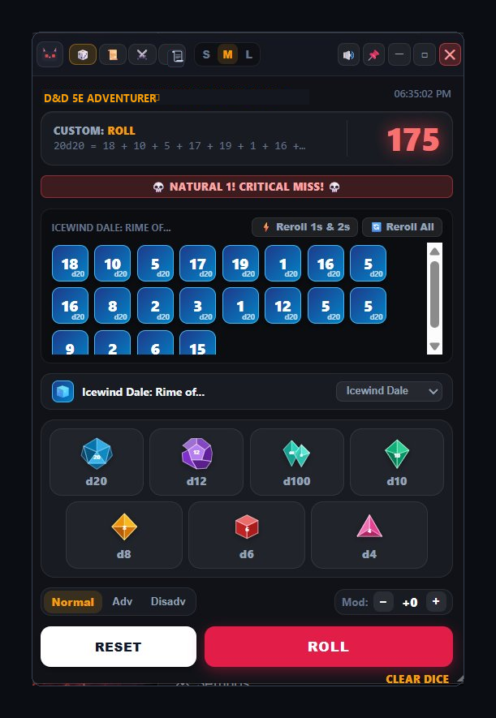

# 🎲 Tabletop RPG Dice Companion Widget

A lightweight floating desktop companion widget for tabletop gaming. Built with Python (`pywebview`), WebView2, and modern HTML/CSS/JavaScript.

<p align="center">
  
</p>

## ✨ Features
- **Polyhedral Dice Roller**: Full polyhedral set (d20, d12, d100, d10, d8, d6, d4) with Advantage, Disadvantage, modifiers, and formula breakdown.
- **Dynamic Reroll System**: Click any individual die to reroll, or use quick actions to reroll 1s & 2s or reroll all.
- **Critical Detection**: Audio and visual animations on Natural 20 and Natural 1 rolls.
- **Combat & Turn Order Tracker**: Initiative order tracker, HP adjustment stepper, and status condition chips.
- **Combo & Macro Vault**: Pre-configured combat combos plus custom macro builder with one-click rolling.
- **Tabletop Audio & Ambience**: Synthesized soundboard effects and background atmospheric ambiences.
- **Interactive Character Sheet & Sheet Importer**:
  - Built-in customizable character sheet template.
  - Import sheets via `.pdf`, `.txt`, or `.md` files or direct paste.
  - Automated attribute and action extraction powered by Gemini AI.
  - 1-click rolling directly from sheet items.
- **AI Companion**: In-app AI assistant for narrative descriptions, rules guidance, and combat tactics.
- **Window Controls**: Always on top (Pin 📌), size presets (S / M / L), draggable header, and edge resizers.

## 🚀 Running from Source
```bash
# Install dependencies
pip install pywebview pypdf google-genai

# Launch application
python dnd_companion/app.py
```

## 📦 Building Executable
```bash
pyinstaller --noconsole --onefile --icon="dnd_companion/dnd_dice.ico" --add-data "dnd_companion/index.html;." --distpath="." --name="DndDiceWidget" dnd_companion/app.py
```

## ⚙️ AI Configuration
Place your Gemini API key inside `dnd_companion/api_key.txt` or configure it directly in the application settings.

## 📄 License
MIT License
